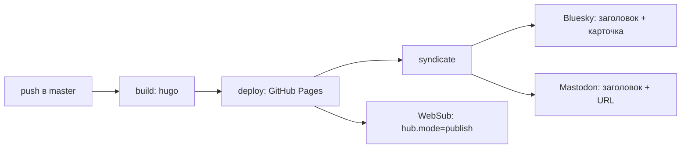

Блог у меня с 2008 года, к сегодняшнему вечеру в нём 832 статьи, 71 из них написана в этом году. Сборка и публикация давно не требуют меня: Hugo собирается в GitHub Actions, артефакт уезжает на GitHub Pages, merge в `master` — единственное действие. А вот анонс статьи в соцсетях всё это время оставался ручным: открыть статью, «поделиться», Buffer, два канала.

Ручным он был до сегодняшнего вечера. Теперь последний job пайплайна сам отправляет новую статью в Bluesky и на infosec.exchange. Ниже — что именно ломалось в ручной схеме (с числами из собственных лент), почему я не взял готовый кросс-постер и как устроен шаг, который публикует анонс без меня.

## Два действия вместо одного

В блоге две регулярные рубрики: длинные технические разборы и «Ссылки» — еженедельный дайджест, который идёт годами и дошёл до четырёхсотого с лишним выпуска. Плюс заметки вроде этой, которые появляются тогда, когда есть что записать.

Публикация статьи на этом не заканчивается. Статья живёт в статике: пока читатель сам не зайдёт на сайт или не обновит ридер, её для него нет. Поэтому сразу после публикации нужен анонс — в Bluesky от имени `denis.evsyukov.org`, в Mastodon от имени `@devsyukov@infosec.exchange`.

То есть каждую статью сопровождали два действия: merge в репозиторий и анонс. Первое жило в репозитории, второе — в телефоне. Это разделение оказалось дороже, чем выглядело.

## Что ломалось

Ломались три вещи, и все три видны в цифрах.

**Пропуски.** С 26 июня, когда в ленте появился первый пост, отправленный через Buffer, вышло 32 статьи. Дошли до лент 30. Не дошли две: «Ссылки #403» 15 августа и «nebula-mesh: 23 уязвимости за четыре с половиной месяца» 1 октября. Ни одну из них я не решил не анонсировать — просто в тот вечер не взял телефон.

**Задержки.** Для этих тридцати статей разрыв между `date:` в front matter и постом в ленте: минимум минута, максимум 4 часа 6 минут, медиана 24 минуты. Самая долгая история — «Ссылки #400» 25 июля, пост вышел через четыре часа после публикации. Само по себе немного, но статья про уязвимости, вышедшая вечером и анонсированная ночью, — это другой разговор с читателем.

**Блокировки.** 2 октября я записал в Bluesky: «Так как bsky веб-приложение заблокировано, пробую использовать witchsky.app». Беда не в том, что клиент не открывается, а в том, что анонс живёт в том приложении, которое сейчас доступно. Нет доступного приложения — нет анонса.

Есть и четвёртая, менее очевидная: анонс нигде не записан. По репозиторию нельзя понять, рассказал ли я о статье; по ленте можно, но для этого её нужно листать. Состояние «опубликовано и анонсировано» существовало только у меня в памяти, а память — не база.

## Зачем анонсировать

Блог статичный, и это его главное свойство: у статьи нет ни комментариев, ни счётчика, ни рекомендаций. Всё, что связывает её с людьми, происходит снаружи — в лентах. Анонс делает три вещи: приводит читателя, приносит ответы и замечания (иногда — указания на фактические ошибки, что полезнее всего) и оставляет след: по ленте видно, что выходило и когда.

Охваты я не измеряю и не оптимизирую. Для блога, который пишется для себя и нескольких сотен читателей, важнее регулярность: читатель привыкает, что по субботам приходят «Ссылки», и знает, где их искать.

## Buffer и телефон

Схема была такой: открываю статью в телефоне, «Поделиться», Buffer[^buffer], два канала — Bluesky и Mastodon. Buffer отправлял в оба канала одну и ту же строку «заголовок + ссылка», и в лентах это видно по времени: посты в двух сетях отличаются на секунды. В Mastodon ещё и виден клиент — `Buffer` в поле «application» почти у всех анонсов с конца июня.

Что в этом хорошо: ноль кода, работает с телефона, требует одного нажатия. Что плохо: это шаг, который существует отдельно от публикации, а значит его можно пропустить; он привязан к телефону, к доступности приложения и к тому, что я вообще вспомнил про анонс; и третья сторона держит доступ к обоим аккаунтам. Последнее — вопрос вкуса, но мне он не нравился: два токена у сервиса, который я не контролирую, ради одной ссылки в неделю.

## Автоматизация: job после деплоя

Требование к замене было одно: анонс должен быть частью публикации, а не отдельным действием. Значит — job в том же workflow, после деплоя.

```yaml
  syndicate:
    needs: deploy
    runs-on: ubuntu-latest
    steps:
      - uses: actions/checkout@v5
        with:
          fetch-depth: 0
      - name: Announce new posts on Bluesky and Mastodon
        env:
          BSKY_HANDLE: ${{ secrets.BSKY_HANDLE }}
          BSKY_APP_PASSWORD: ${{ secrets.BSKY_APP_PASSWORD }}
          MASTODON_INSTANCE: ${{ vars.MASTODON_INSTANCE || 'https://infosec.exchange' }}
          MASTODON_TOKEN: ${{ secrets.MASTODON_TOKEN }}
          BASE_SHA: ${{ github.event.before }}
          HEAD_SHA: ${{ github.sha }}
        run: |
          python3 .github/scripts/syndicate.py --base "$BASE_SHA" --head "$HEAD_SHA"
```

`fetch-depth: 0` здесь не для красоты: скрипту нужны оба коммита диапазона, чтобы понять, что именно добавилось.



### Почему не готовый сервис

Соблазн был взять то, что уже умеет кросс-постить. У Buffer есть API и расписание, мосты вроде Bridgy Fed переносят посты между Mastodon и Bluesky[^bridge], у Zapier и IFTTT есть готовые рецепты «новый пост в ленте → пост в соцсети». Каждый из вариантов требует отдать второму сервису токен на запись в аккаунт, и каждый ограничен чужим шаблоном текста. Мне нужно было ровно одно: заголовок с карточкой в Bluesky и «заголовок + URL» в Mastodon. Свой скрипт на стандартной библиотеке оказался дешевле, чем интеграция с чужим API и разбор того, почему он иногда ставит текст не так.

### Что считается новой статьёй

`git diff --name-only --diff-filter=A <before> <head> -- content/posts` — только добавленные файлы. Правки, пересборки, деплои без новой статьи не анонсируют ничего. Пустой или нулевой `before` (первый push, force-push) — тоже ничего: лучше промолчать, чем угадывать.

### Секреты

| Секрет | Откуда берётся |
| --- | --- |
| `BSKY_HANDLE` | хэндл в Bluesky, `denis.evsyukov.org` |
| `BSKY_APP_PASSWORD` | bsky.app → Settings → App Passwords |
| `MASTODON_TOKEN` | infosec.exchange → Preferences → Development → New application |
| `MASTODON_INSTANCE` | переменная репозитория, не секрет: `https://infosec.exchange` |

Два места, где легко ошибиться. В Bluesky нужен app password, а не пароль аккаунта: его можно отозвать отдельно, не меняя пароль. В Mastodon нужны scopes `write:statuses read:accounts read:statuses`[^mastotoken] — скоупы на чтение нужны для проверки «а не опубликовано ли уже»; поменять их у созданного приложения нельзя, только создать новое.

Хэндл при этом публичный, но лежит в секретах — чтобы не попадать в лог: GitHub маскирует значения из `secrets.*` на всей странице прогона[^secrets]. В логе вместо него печатается DID, `did:plc:y4dgayi5tvejbs6oawnli6db`: он однозначно указывает на аккаунт и ничего не выдаёт.

### Формат: скопировать у себя, а не придумать

Первая версия скрипта писала в Bluesky заголовок, ссылку и до трёх тегов, с facet'ами — разметкой ссылок и тегов, где смещения считаются в байтах UTF-8, а не в символах[^posts]. Технически всё было правильно и на тестах работало. Только в ленте это выглядело чужеродно: мои посты попадали туда из клиента, который ставит заголовок и карточку ссылки, без URL в тексте.

Пришлось переписать под то, что уже есть. Bluesky получает заголовок в тексте и карточку `app.bsky.embed.external`, собранную из `og:title`, `og:description` и `og:image`; Mastodon — одну строку «заголовок URL». Тегов и лида в тексте нет, facets больше не нужны, код с байтовыми смещениями удалён, а тест теперь проверяет противоположное: URL в тексте отсутствует, facets нет, карточка на месте. Автоматические посты не отличаются от ручных — это и было целью.

### Почему анонс — это не «просто POST»

Три вещи, которые в статике не гарантированы.

**Пермалинк может ещё не отвечать.** То, что `deploy` закончился, не значит, что CDN отдаёт страницу. Скрипт стучится в пермалинк до двенадцати раз с паузой в пять секунд, а если угаданный путь по дате не отвечает — ищет слаг в `sitemap.xml`: дата в front matter и дата в URL совпадают не всегда. Если страницы нет вообще, анонса не будет. Заодно это ловит статью с датой в будущем: Hugo такие не собирает, и делать вид, что она вышла, не нужно.

**Заголовок и лид берутся со страницы, а не из исходника.** `og:title` и `og:description` — это то, что видит читатель. Карточка не может описывать страницу, которая не собралась.

**Повторный запуск не должен дублировать.** В Bluesky ключ записи (`rkey`) — это слаг статьи[^getrecord], поэтому проверка перед публикацией либо находит запись, либо получает ошибку, и повторная попытка не создаёт второй пост. В Mastodon такого ключа нет: `Idempotency-Key` живёт час и защищает только от повторов внутри прогона[^mastoapi]. Поэтому скрипт читает последние сорок своих статусов и ищет в них URL статьи.

### Выключатель

`syndicate: false` в front matter — статья публикуется, но не анонсируется. `draft: true` пропускается сам. Ручной запуск: Actions → *Build and deploy* → *Run workflow*, где есть поле `slug` для одной статьи и `dry_run`, включённый по умолчанию. Dry run при этом всё равно логинится в обе сети и делает проверку на дубль — то есть проверяет токены, а печатает только payload. Смысл в этом есть: dry run, который возвращается до авторизации, проверяет шаблон текста и оставляет токены непроверенными до первого настоящего поста, то есть ровно до того момента, когда плохой токен стоит анонса.

## Проверка и результат

Сначала локально, без аккаунтов: `test_syndicate.py` поднимает два фейковых сервера — PDS Bluesky и Mastodon — и прогоняет скрипт дважды. Реальный вывод:

```
--- run 1 (slug: websub-static-blog)
announcing websub-static-blog -> https://www.juev.org/2026/10/17/websub-static-blog/
  bluesky: signed in as juev.bsky.social (did:plc:test)
  bluesky: posted at://did:plc:test/app.bsky.feed.post/websub-static-blog
  mastodon: signed in as @juev
  mastodon: posted https://example.invalid/@juev/1
--- run 2 (slug: websub-static-blog)
  bluesky: skipped already announced (rkey websub-static-blog)
  mastodon: skipped already announced

bluesky records: 1, mastodon statuses: 1, blobs: [{'type': 'image/png', 'size': 14757}]
OK
```

Первый прогон публикует, второй находит оба поста уже на месте, картинка для карточки уезжает блобом. Моки проверяют не только «запрос ушёл»: текст в Bluesky без URL и короче трёхсот символов, facets отсутствуют, `langs` — `ru`, у Mastodon заполнены `visibility` и `language`, а `Idempotency-Key` на месте.

Потом — dry run в самом Actions, уже с настоящими токенами, 17 октября в 23:48 по Москве:

```
announcing websub-static-blog -> https://www.juev.org/2026/10/17/websub-static-blog/
  (dry run: nothing will be posted)
  bluesky: signed in as *** (did:plc:y4dgayi5tvejbs6oawnli6db)
  bluesky: dry-run credentials and duplicate check OK, nothing posted
  mastodon: signed in as @devsyukov
  mastodon: skipped already announced
```

Две строки в этом выводе стоят отдельного разбора.

`mastodon: skipped already announced` — сработала проверка на дубль. Статью про WebSub я анонсировал вручную через Buffer за тридцать пять минут до dry run, и скрипт нашёл её URL среди последних статусов. То есть защита от дубля работает не только против самой себя: она видит и посты, отправленные руками.

А на Bluesky в этой же ситуации написано «credentials and duplicate check OK», и настоящий прогон создал бы второй пост. Потому что ключ записи там — слаг, а у постов, отправленных клиентом, ключ другой. Проверка на дубль в Bluesky видит только то, что опубликовал этот скрипт. Отсюда правило: бэкфиллить старые статьи нельзя. Первой настоящей публикацией станет анонс этой статьи — он же и проверит то, что dry run проверить не может: право записи в оба аккаунта.

## Чего пока нет

- **Право записи не проверено ни разу.** Создание статуса в Mastodon и записи в Bluesky в настоящем аккаунте случится на первом реальном прогоне. Если токен не тот, job покраснеет, анонса не будет — поправимо и заметно, но заметно в Actions, а не в уведомлении.
- **Нет ретраев.** 429 или 502 от сети — провал шага. Идемпотентность делает повтор безопасным, но повторять руками.
- **Никто не следит.** Job падает и молчит: уведомлений из Actions у меня нет. Это та же болезнь, что у шага с WebSub, только там хотя бы `continue-on-error`.
- **Одна запись на статью.** Ни тредов, ни отдельного текста для каждой сети: обе получают заголовок. Для моих статей хватает, для текста с интригой в лиде — нет.
- **Buffer никуда не делся.** Он остался для всего, что не статья, и как запасной путь, если токен отвалится.

## Что из этого следует

Анонс перестал быть действием. Публикация статьи теперь — merge, остальное происходит само, в том числе когда я в этот момент сплю или без ноутбука. Пропустить анонс стало нельзя, потому что пропускать больше нечего.

Самая полезная часть работы — не скрипт на 537 строк, а сверка с тем, что уже опубликовано. Первая версия была технически правильнее и выглядела чужой; вторая просто повторяет мои же посты. Когда автоматизация делает «лучше, чем человек», обычно это заметно именно по формату.

И третье, менее очевидное: у блога появилось состояние, которого не было. Репозиторий знает, какие статьи анонсированы, — как минимум те, что анонсировал он сам. До этого знание жило в ленте и в памяти, и оба источника иногда подводили.

Заодно этот шаг закрыл второй круг той же задачи: сборка теперь не только публикует страницу и [пингует хаб WebSub](), но и рассказывает о статье там, где её читают.

[^getrecord]: [com.atproto.repo.getRecord](https://docs.bsky.app/docs/api/com-atproto-repo-get-record), AT Protocol. Запись `app.bsky.feed.post` адресуется парой «коллекция + rkey»; создание — [com.atproto.repo.createRecord](https://docs.bsky.app/docs/api/com-atproto-repo-create-record), авторизация — [com.atproto.server.createSession](https://docs.bsky.app/docs/api/com-atproto-server-create-session).
[^mastoapi]: [Mastodon API: статусы](https://docs.joinmastodon.org/methods/statuses/), `POST /api/v1/statuses` и параметр `Idempotency-Key`: значение хранится один час.
[^posts]: [Bluesky: посты, facets и embed](https://docs.bsky.app/docs/advanced-guides/posts). Смещения facet'ов считаются в байтах UTF-8, карточка ссылки — `app.bsky.embed.external`.
[^mastotoken]: [Mastodon: получение токена](https://docs.joinmastodon.org/client/token/) и [работа с приложениями](https://docs.joinmastodon.org/methods/apps/): токен выдаётся приложению с фиксированным набором scopes.
[^secrets]: [GitHub Actions: секреты](https://docs.github.com/en/actions/how-tos/write-workflows/choose-what-workflows-do/use-secrets). Значения маскируются в логе, в workflow доступны только через `secrets.*`.
[^bridge]: [Bridgy Fed](https://fed.brid.gy), мост между ActivityPub и AT Protocol: подписка на аккаунт в одной сети и репост в другой.
[^buffer]: [Buffer](https://buffer.com) — планировщик постов в несколько каналов; в моей схеме отправлял один и тот же текст в Bluesky и Mastodon.
