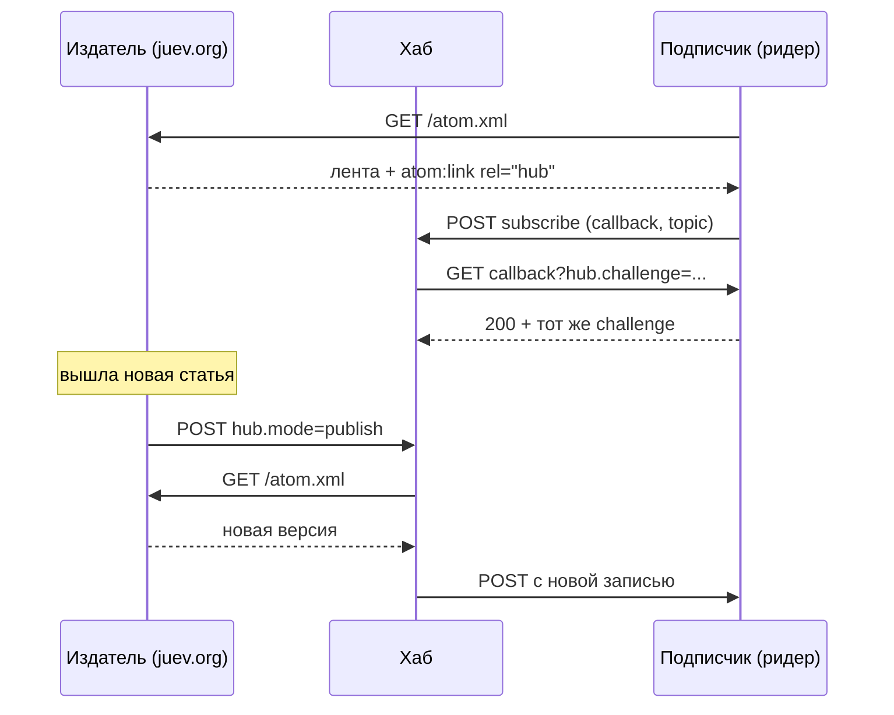

Блог у меня статичный: Hugo собирает страницы в GitHub Actions, артефакт уезжает на GitHub Pages. Между деплоями не живёт ни один процесс — только файлы в CDN. Значит, о новой статье читатель узнаёт тогда, когда сам сходит за лентой. Пока его ридер не опросил `atom.xml`, статьи для него не существует.

Так было до прошлой недели. Теперь лента объявляет хаб WebSub, а workflow после деплоя дёргает его одним `curl`. Это не переписывание публикации, а две правки в шаблонах и один шаг в пайплайне. Но история с продолжением: ту же самую штуку я настраивал в 2015 году для Jekyll, а потом потерял её при переезде на Hugo.

## Что такое WebSub и в чём выигрыш

WebSub — протокол, в котором у публикации три участника: издатель, хаб и подписчик. Издатель объявляет, что у его ленты есть хаб: в самой ленте тегом `atom:link` с `rel="hub"` или заголовком `Link` в ответе на запрос ленты. Подписчик, увидев объявление, отправляет хабу `hub.mode=subscribe` со своим адресом `hub.callback` и адресом ленты `hub.topic`. Хаб проверяет намерение: идёт GET-ом на callback с параметром `hub.challenge`, и подписчик должен вернуть это значение обратно. Только после этого подписка считается настоящей — так протокол защищается от того, чтобы чужой сайт подписал вас на что попало. Живёт подписка ограниченное время (lease), и продлевать её — забота подписчика, не издателя.

Дальше — главное. Когда выходит статья, издатель отправляет хабу POST с `hub.mode=publish` и `hub.url`. Хаб сам забирает ленту, сравнивает с тем, что у него было, и рассылает новое подписчикам. Если подписчик передал при подписке `hub.secret`, доставка приходит с HMAC-подписью.



Стандарт принят как W3C Recommendation: первая редакция — январь 2018, действующая переиздана 2 июня 2026[^rec]. До этого протокол назывался PubSubHubbub, и именно под этим именем он был у меня в 2015 году: в [той статье]() есть Rakefile-задача `ping`, которая отправляла `hub.mode=publish` на `pubsubhubbub.appspot.com`. Потом сайт переехал с Jekyll на Hugo, Rakefile исчез, и пинг исчез вместе с ним — незаметно, потому что ничего не ломалось.

Выигрыш у WebSub ровно один, но он тот, который статике недоступен иначе: задержка.

- **Время.** При опросе раз в час средняя задержка — полчаса, худший случай — час. Пуш приходит за секунды: на моём последнем пинге хаб забрал ленту через девять секунд.
- **Трафик.** Лента сейчас весит 125 КБ (пять статей с полным текстом). Час опроса — это до 2.9 МБ в сутки на одного читателя, если ридер не умеет условный GET. GitHub Pages отдаёт `ETag` и `Last-Modified`, так что аккуратный ридер получает `304` и почти ничего не тратит. Поэтому главное преимущество — не трафик, а время: выигрыш в трафике здесь во многом заслуга HTTP-кеша, а не WebSub.
- **Цена для издателя.** Ноль инфраструктуры: ни базы подписчиков, ни очереди, ни вебхука, который надо держать доступным. Всё, что нужно от блога, — объявить хаб и отправить один POST.

Обратная сторона того же: у издателя нет никакой обратной связи. Ни счётчика подписчиков, ни статистики доставки — этим занимается хаб, и он вам ничего не расскажет. Об этом ниже, в результатах.

## Какие хабы бесплатные

Публичных хабов, куда можно прийти без регистрации и ключа, немного. Я проверил их руками 17 октября: отправил `hub.mode=publish` для своего фида и посмотрел, что ответит.

| Хаб | Пинг моего фида | Заметки |
| --- | --- | --- |
| `https://pubsubhubbub.appspot.com/` | `204 No Content` | Публичный хаб Google, без регистрации. Спецификация 0.4; в 0.3, по их же оговорке, нет постоянных подписок[^g] |
| `https://websub.superfeedr.com/` | `204 No Content` | Публичный хаб Superfeedr, тот же протокол. Свой хаб у них — платная услуга[^sf] |
| `https://websubhub.com/hub` | `500`, «Topic not found for topic URL» | Бесплатный и полностью совместимый с REC 2018, прогнан по `websub.rocks`[^wsh], но работает от подписчика: пинги от произвольного издателя не принимает |
| `https://websub.rocks/` | — | Валидатор и временный тестовый хаб, не для продакшена[^rocks] |

Отдельный вариант — поднять свой хаб. Реализации есть, но выбор тонкий: Go-тулкит с подписчиком, издателем и хабом `Jazzmoon/websub`, `tystuyfzand/websub-server` с пулом воркеров, старый `thylacine/websub-hub` 2012 года. Для блога с одной лентой это лишняя инфраструктура, которую придётся бэкапить, обновлять и мониторить, — ровно то, чего у статики нет по определению.

Практический вывод простой: для издателя бесплатный выбор — Google или Superfeedr, и оба принимают пинг без ключей. Выбирать между ними по документации смысла мало: важно, что при смене хаба меняются две строки — в шаблоне ленты и в workflow.

## Как это включено у меня

Сайт — Hugo на GitHub Pages. Понадобились три правки в одном коммите.

**Первая: объявление хаба в ленте.** Лента у меня не генерируется темой, а лежит своим шаблоном `layouts/index.xml`. Тег `rel="hub"` встал рядом с уже существующим `rel="self"`:

```go-html-template
{{ with .OutputFormats.Get "RSS" -}}
{{ printf "<atom:link href=%q rel=\"self\" type=%q />" .Permalink .MediaType | safeHTML }}
<atom:link href="https://pubsubhubbub.appspot.com/" rel="hub" />
{{ end -}}
```

**Вторая: тип ленты в HTML.** В `layouts/_default/baseof.html` строка обнаружения ленты была с типом `application/rss` — без `+xml`. Мелочь, но именно по ней ридеры и находят фид, а по спецификации MIME-тип должен быть корректным, поэтому заодно исправил на `application/rss+xml`.

**Третья: пинг после деплоя.** Шаг добавлен в конец job'а `deploy`, после `actions/deploy-pages`, а не до него:

```yaml
- name: Notify WebSub hub
  continue-on-error: true
  run: |
    curl -fsS --retry 3 -X POST https://pubsubhubbub.appspot.com/ \
      -d hub.mode=publish \
      -d hub.url=https://www.juev.org/atom.xml
```

Порядок здесь — не стилистика. Хаб забирает ленту сразу после пинга, поэтому пинг раньше публикации означал бы, что он прочитал старую версию и разослал подписчикам пустоту. `-f` нужен, чтобы HTTP-ошибка была видна в логе, `continue-on-error` — чтобы недоступный хаб не ронял публикацию статьи: блог важнее уведомления.

Заодно в том же коммите поднял Hugo с 0.164.0 до 0.167.0. Коммит `89d9eda`, прогон `38231090679`.

## Результат

Что проверено, а не предположено.

- В живой ленте объявление есть: `atom:link href="https://pubsubhubbub.appspot.com/" rel="hub"` отдаётся прямо сейчас.
- Ручной пинг отвечает `204`, и это не «принято и забыто». У хаба Google есть диагностика по адресу ленты (`/topic-details`): `last ping` — 17 октября 19:59:24 UTC, `last successful fetch` — 19:59:33. Девять секунд, и в поле «last item retrieved» лежит последняя статья с полным текстом.
- Шаг отработал в четырёх прогонах: 12, 15 и дважды 17 октября. Все зелёные.
- Подписка работает не только в теории: freshgo на моём сервере 15 октября в 10:52:53 записал в журнал `asked the WebSub hub to push`, где `topic=https://www.juev.org/atom.xml`, а `hub=https://pubsubhubbub.appspot.com/`. То есть мой собственный ридер нашёл хаб в ленте и подписался на него сам, без настройки.
- У хаба для этого адреса сохранилась последняя ошибка — 4 сентября 2018 года, HTTP 404. Значит, лента была у него уже в 2018-м, за восемь лет до этой правки.

Чего я не вижу. GitHub Pages не отдаёт логи доступа, поэтому ни число подписчиков, ни фактическую доставку измерить нельзя: виден только факт, что хаб забрал ленту. Это принципиальное свойство схемы — WebSub не аналитика. Если нужен счётчик читателей, его даёт что-то другое, и прикручивать к пушу пиксель бессмысленно.

## Что можно было сделать лучше

- **Пинг условный, а не на каждый деплой.** Сейчас уведомление уходит при любой правке в шаблонах, даже когда лента не изменилась. Хаб в этом случае забирает фид зря. Правильнее сравнить хеш `atom.xml` с предыдущим деплоем, но для блога, который собирается несколько раз в неделю, лишний fetch дешевле лишнего кода.
- **Шаг молчит при ошибке.** `continue-on-error` защищает публикацию, но и скрывает проблему: если хаб отвечает `500` месяц, я об этом не узнаю. Наблюдения за этим шагом у меня нет.
- **Хаб чужой.** У Google нет ни SLA, ни публичной страницы состояния, а копирайт на странице хаба — 2022 года. Замена — две строки, но менять надо синхронно: шаблон ленты и workflow. Если станет важно, свой хаб решает вопрос, но превращает статичный блог в сервис.
- **В ленте пять статей.** Если выпустить за один деплой больше, часть записей в пуш не попадёт: хаб рассылает то, что увидел. Для блога это не проблема, для новостного сайта — была бы.

## Заключительные мысли

WebSub — редкий случай, когда спецификация W3C, десять строк реализации и ноль зависимостей дают то, чего у статики не было вовсе: блог сам сообщает о публикации. Ни сервера, ни базы, ни фонового процесса. Плата — невидимость: результат виден только в чужом журнале.

Вторая мысль — про то, как такие вещи теряются. В 2015 году это был Rakefile и пинг по HTTP, в 2026-м — шаг workflow. Сам протокол от этого не изменился, изменилась только обвязка. Исчезло не знание, а место, где оно жило: у Jekyll была задача `notify`, у Hugo такой задачи нет, и никто не заметил пропажи. Возвращать пришлось не столько пинг, сколько привычку сверять, что пережило переезд.

*Примечание. Статья написана deepseek-flash по результатам работы на сервере.*

[^rec]: [WebSub, W3C Recommendation](https://www.w3.org/TR/websub/), действующая редакция от 2 июня 2026 года; первая — [23 января 2018](https://www.w3.org/TR/2018/REC-websub-20180123/).
[^g]: [Google PubSubHubbub Hub](https://pubsubhubbub.appspot.com/), описание протокола и оговорка про 0.3: постоянных подписок в этой версии нет, продлевать нужно вручную.
[^sf]: [WebSub's PubSubHubbub Hub](https://websub.superfeedr.com/), публичный хаб Superfeedr; собственный хаб предлагается как отдельная услуга.
[^wsh]: [WebSubHub](https://websubhub.com/), бесплатный хаб с единственным эндпоинтом `/hub`, протестирован по набору `websub.rocks`.
[^rocks]: [WebSub Rocks!](https://websub.rocks/), валидатор издателей, подписчиков и хабов; для тестов поднимает временный блог.
